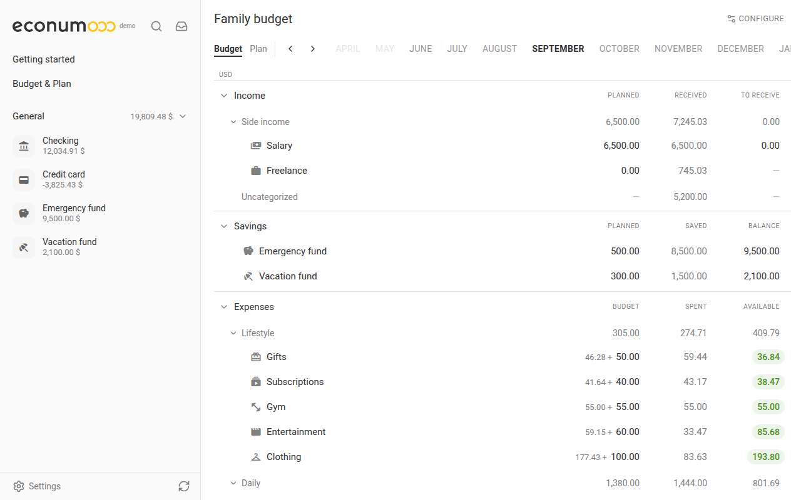

<p align="center">
    <picture>
        
    </picture>
</p>

<p align="center">
    A getting started guide to self-hosting <a href="https://econumo.com/docs/edition" target="_blank">Econumo</a> — a personal finance & budgeting app
</p>

---

Econumo ships as a single, self-contained Go binary in a distroless Docker image.
It serves both the API and the web app, runs database migrations automatically on
boot, and works with SQLite (default) or PostgreSQL.

<p align="center">
    
</p>

> [!IMPORTANT]
> The Docker image is now published to the **GitHub Container Registry**:
> `ghcr.io/econumo/econumo`. The old Docker Hub image (`econumo/econumo-ce`)
> belongs to v0.x and is no longer updated — update your `docker-compose.yml`
> or pull references accordingly.

### Quick start

You'll need [Docker](https://docs.docker.com/engine/install/) with
[Compose](https://docs.docker.com/compose/install/). The app itself is
lightweight — it consumes up to 10 MB of RAM.

```console
$ git clone --single-branch https://github.com/econumo/econumo
$ cd econumo
$ cp .env.example .env
$ docker compose pull && docker compose up -d
```

Then visit `http://localhost:8181` and create the first user.

> [!NOTE]
> To build the image from source instead of pulling, run
> `docker compose up -d --build` (the `Dockerfile` is in
> [`deployment/docker/`](deployment/docker/Dockerfile)). Health is reported
> at `/health`.

### Configuration

Everything is configured through environment variables in `.env` —
[`.env.example`](.env.example) is the full, commented reference for every
setting (database, mail, currencies, CORS, logging). The defaults
work out of the box: SQLite storage and registration enabled; the only
variables most setups ever touch are `DATABASE_URL` (to switch to PostgreSQL)
and `MAILER_DSN` (to send password-recovery email).

CLI commands (create users, update currency rates, …) run through the binary
inside the container, e.g.:

```console
$ docker compose exec econumo /app/econumo user:create "Name" user@example.com password
```

### Run without Docker (single binary)

Prefer not to use Docker? Every release also ships self-contained Linux
binaries with the web UI embedded, runnable under systemd on a single host.
See [docs/run-without-docker.md](docs/run-without-docker.md) for the full
walkthrough.

